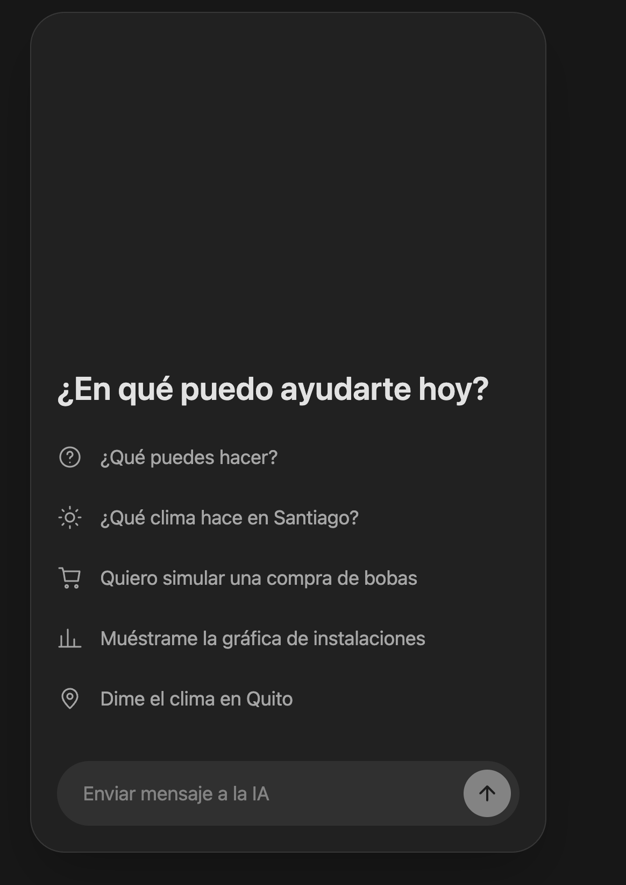
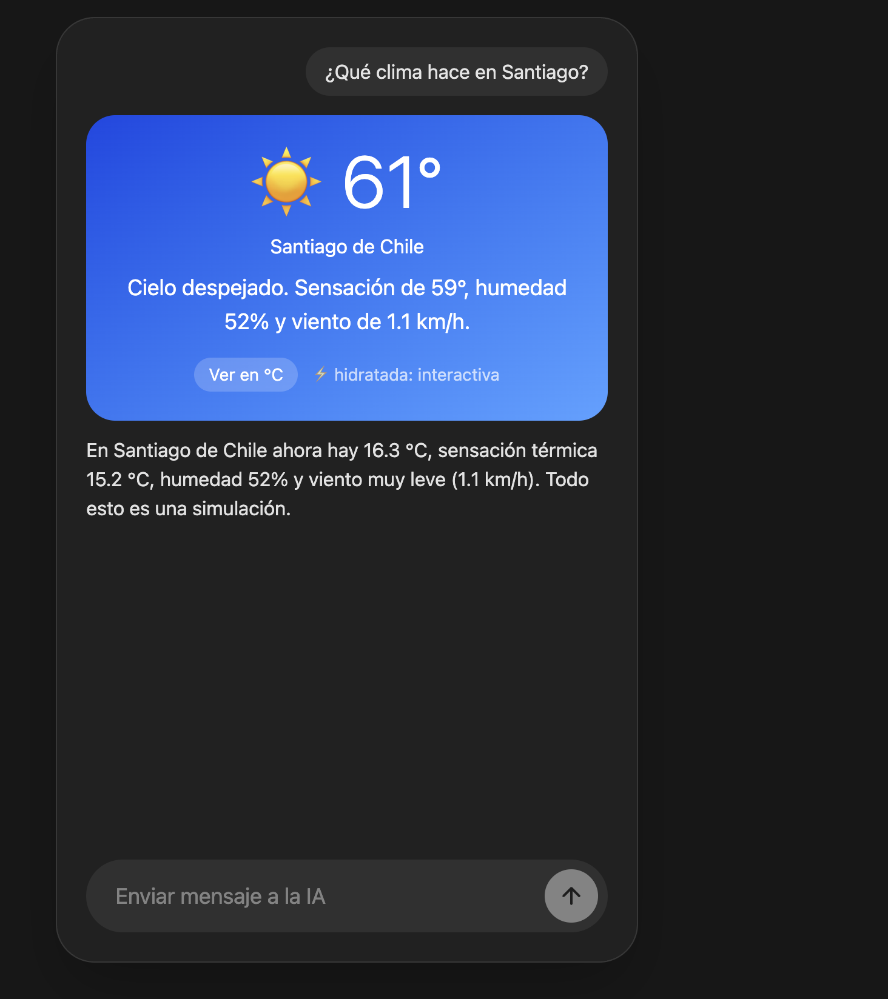
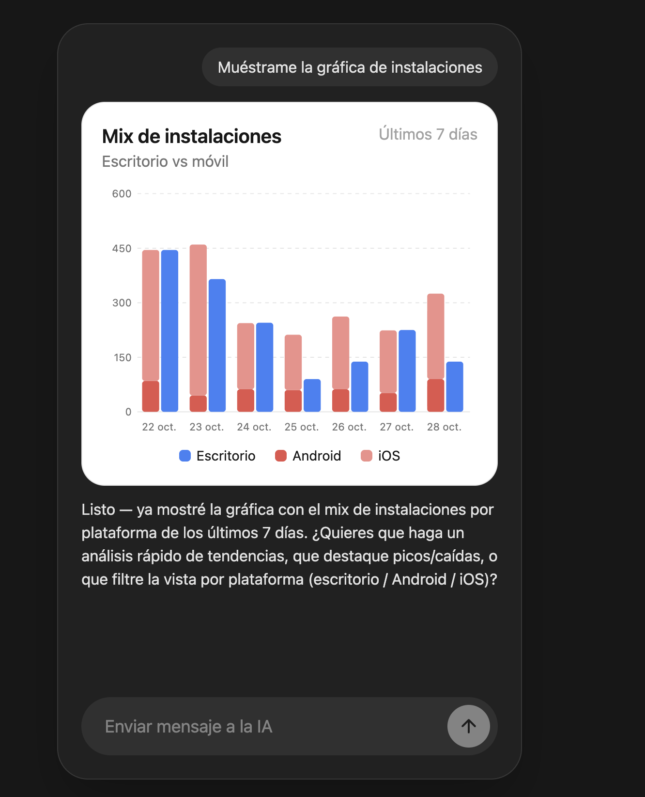

# aisdk-server-driven-ui

Chat con el [AI SDK](https://ai-sdk.dev) de Vercel y Azure OpenAI donde **el backend controla la interfaz**: cada tool renderiza un componente de React en el servidor, lo sirve como módulo y el frontend, agnóstico, solo lo pinta y lo hidrata.

| Inicio | Clima (hidratado) | Gráfica desde el servidor |
| --- | --- | --- |
|  |  |  |

## Cómo funciona

1. El modelo llama a una tool (`getWeather`, `showInstallChart`, `showCart`).
2. La tool renderiza el componente con `renderToString` y devuelve `{ module, props, html }`.
3. El backend compila cada componente a un módulo ESM (`Bun.build`) y lo sirve en `/ui/:file`.
4. El frontend pinta el `html` al instante, hace `import(module)` y llama a `hydrate`: React reutiliza el DOM y le conecta eventos y estado (por ejemplo, el botón °C/°F o el carrito).
5. `toModelOutput` envía al modelo solo los `props`, nunca el HTML.

El frontend no importa ningún componente: agregar uno nuevo no lo toca.

## Estructura

```
src/
├── backend/
│   ├── main.ts                  # composición de dependencias y Bun.serve
│   ├── api/                     # controllers y casos de uso (chat/run-agent)
│   ├── components/              # componentes React renderizados por el servidor
│   ├── domain/                  # catálogo y errores
│   └── services/                # Azure, clima, UI y agentes (tools en *.tool.ts)
└── frontend/
    ├── main.tsx, app.tsx        # chat
    └── ui/components/server-component/   # pinta el HTML e hidrata el módulo
```

El código sigue las convenciones de clases con inyección por constructor, `_` en miembros privados, kebab-case y formato Biome.

## Uso

Requiere [Bun](https://bun.com) y un deployment de Azure OpenAI (chat completions).

```bash
bun install
```

Crea un `.env` con:

```
AZURE_OPENAI_BASE_URL="https://<recurso>.cognitiveservices.azure.com/openai/v1"
AZURE_OPENAI_API_KEY="..."
AZURE_OPENAI_API_VERSION="v1"
AZURE_OPENAI_GENERATIVE_DEPLOYMENT="<nombre-del-deployment>"
```

```bash
bun dev      # http://localhost:3000
bun start    # producción
```

El clima viene de [Open-Meteo](https://open-meteo.com) (sin API key). La gráfica y el carrito usan datos simulados.
